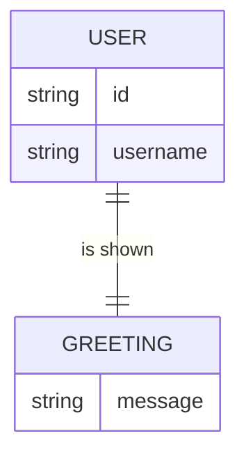

# Domain model

The product stores no data of its own. The signed-in person is owned by the identity provider, and the greeting is a fixed value the API returns.

`USER` is held by Thunder; the app only reads the session and never persists it. `GREETING` is the API's `Greeting` schema: one constant message, the same for every user, not stored.