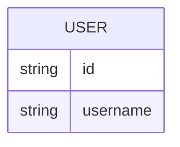

# Domain model

The product stores no data of its own. The only entity is the signed-in person, owned by the identity provider.

`USER` is held by Thunder; the app only reads the session and never persists it.